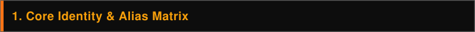
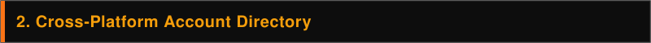

<table>
  <tr>
    <td>
      
    </td>
    <td>
      <picture>
        <source media="(prefers-color-scheme: dark)" srcset="./assets/header-dark.svg">
        <source media="(prefers-color-scheme: light)" srcset="./assets/header-light.svg">
        
      </picture>
    </td>
  </tr>
</table>

**Också Stewart** (also operating under  and ) is a 26-year-old multi-instrumentalist, photographer, and bilingual writer of Swedish and Italian heritage based in **San Antonio, Texas**. Across a documented 17-year timeline (2009–2026), their digital footprint spans early web archives, visual art, photography, custom web tools, sheet music notation, experimental electronic music, and long-form essays.

---

<picture>
  <source media="(prefers-color-scheme: dark)" srcset="./assets/section-1-dark.svg">
  <source media="(prefers-color-scheme: light)" srcset="./assets/section-1-light.svg">
  
</picture>

* **Primary Display Name:** Också Stewart (`också`)
* **Primary Handle:** `ockfeld` (used across , , , , , , , )
* **Legacy & Suffix Handles:**  (2009 Microsoft Live email & DeviantArt),  (YouTube & Blogger alias matrix),  (YouTube), and  (mutually linked DeviantArt account)
* **Additional Video Handles:** , , and  (cataloged in Flickr archive entry `meowmix6782`)
* **Location & Personal Background:** San Antonio, TX (with documented 2023 musical roots in Philadelphia, PA); identifies as a 26-year-old queer/bisexual man of Swedish-Italian descent with an INTJ-T personality profile and autism spectrum diagnosis (`autismspektrumstörning`).

---

<picture>
  <source media="(prefers-color-scheme: dark)" srcset="./assets/section-2-dark.svg">
  <source media="(prefers-color-scheme: light)" srcset="./assets/section-2-light.svg">
  
</picture>

| Platform | Account / Identifier | Verified Stats & Role |
| :--- | :--- | :--- |
| **Yolasite (Legacy)** |  | Early 2009 site inviting users to email animal photos to  (`skapade detta 2009`). |
| **DeviantArt** |   | Active ~2010–2015; mutually linked in bios with overlapping anime/manga interests (*Case Closed*, *Negima!*, *Ranma 1/2*). |
| **SpaceHey** |  | Central social hub (120 friends) linking active accounts and hosting meta-fictional essays (*Twin Peaks*, *Genshiken*). |
| **Flickr** |  | Joined October 2019; **5,946 photos**, 49 followers, 232 following. Includes the 327-photo  (`72177720335215107`). |
| **GitHub** |  | Hosts  (102 commits) a  for random browsing of the Flickr archive. |
| **Instagram** |  | Active public feed (**288 posts**, 441 followers) geotagged in San Antonio, TX, featuring photography and their cat, Tofu. |
| **Steam** |  | Level 45 gaming profile with **379 games**, 346 DLC, 624 screenshots, 35 badges, and 93 friends. |
| **YouTube** |  | Gaming and raw clip archive with 100+ uploads, including a *Pokémon Crystal* Elite Four milestone run. |
| **MuseScore (Legacy)** |  | Sheet music and notation accounts (, , , , , , ) documented in the October 2026 Flickr archive index. |
| **Bandcamp** |   | Hosts solo and collaborative electronic/experimental releases from 2023 and 2026. |
| **Blogger** |    | Three interconnected sites containing 45 combined essays, logs, and poems written between May and October 2026. |

---

<picture>
  <source media="(prefers-color-scheme: dark)" srcset="./assets/section-3-dark.svg">
  <source media="(prefers-color-scheme: light)" srcset="./assets/section-3-light.svg">
  
</picture>

* ** — *Ground State* (January 27, 2023 | Philadelphia, PA)**
  * **Credits:** Collaborative electronic project by **Också Stewart** and **Hayden McGarvey** (`hmmcg`).
  * **Tracklist:** *dollar store reverb* (03:28), *moby's pizza* (02:25), *bluerose* (01:33), *guilty spark* (02:42), and *something on the radio but you just got your wisdom teeth removed* (03:46).
* **DOB-OCK —  (October 23, 2026 | San Antonio, TX)**
  * **Credits:** Continuation of the *Grassware* subgenre project by **Hayden McGarvey** and **Också Stewart**.
  * **Tracklist:** *DOB-OCK i demo* (01:49), *DOB-OCK ii demo* (01:27), *DOB-OCK iii stu* (01:51), *DOB-OCK iv stu* (02:02), and *DOB-OCK v stu* (03:08).
* ** — *medan du tjänar* (October 26, 2026 | San Antonio, TX)**
  * **Details:** Solo experimental/hymnal single (02:23); Swedish title translates to *"while you serve"* or *"as you serve".*
* **Extended Collaborator Network: Trusselina (Philadelphia, PA / JOLT MUSIC)**
  * **Connection:** Co-founded by **Hayden McGarvey** alongside **Mikaela Oppenheimer**, linking Också's primary musical collaborator to the Philadelphia indie/alternative circuit.
  * **Releases:** *(Live) Texas/Mama Doves Flying* (September 2025), *Gastro / Trusselina Archimboldi* (July 2026), and the 8-track LP *The Point's a Truss, My Trusselina* (October 9, 2026, released two weeks prior to *DOBSONIAN SYNKOPE*).
* **Offline & Notation Archive:** Maintains an 8-year-old, 304 GB bit-perfect lossless local audio database alongside seven legacy MuseScore accounts reflecting formal music theory and notation practice.

---

<picture>
  <source media="(prefers-color-scheme: dark)" srcset="./assets/section-4-dark.svg">
  <source media="(prefers-color-scheme: light)" srcset="./assets/section-4-light.svg">
  
</picture>

* **2009 | Early Web Footprint:** Creates  using the email  to collect and upload animal photos.
* **2010–2015 | DeviantArt & Early Video:** Launches DeviantArt profiles  (2010) and  (2015) and establishes early YouTube channels using the `6782` suffix (, ).
* **October 2019 | Photography Archive Launch:** Joins Flickr (), initiating an unedited camera-roll archive that grows to nearly 6,000 uploads.
* **January 2023 | Philadelphia Electronic Release:** Collaborates with Hayden McGarvey as  to release *Ground State* in Philadelphia, PA.
* **November 2024 | Personal Crisis Catalyst:** Records retrospective crisis logs detailing severe depression, nightmares, and a pivotal relational rupture—later processed into structured writing.
* **May – August 2026 | :** Publishes 29 posts organizing raw trauma fragments, 2024 crisis journals, and a 22-part manifesto (*Excerpts #001–#022*) on post-traumatic sovereignty, Daoist anti-curation (*Pǔ*), ambient nervous-system regulation, and Zappa-inspired critiques of the Philadelphia indie scene.
* **August – October 2026 | :** Publishes 7 bilingual (Swedish/English) essays examining queer geographic isolation in Texas through Prefab Sprout's *Swoon* alongside technical musicology analyses of Steve Roach, Laetitia Sadier, Korn, and Dystopia.
* **October – November 2026 | Collaborative Poetry, Music & Web Archaeology:**
  *  Published on **October 12** (9 posts) featuring French poems (*Sous l'Éclipse*, *Te voilà*) by partner **Mountaha** and seven analytical reflections (*"meddelande till min älskade - 01"* to *07*).
  * Releases  and  on  (Oct 23 & 26).
  * Catalogs legacy YouTube/MuseScore links (`meowmix6782`, Oct 28) and the 2009 Yolasite page (`site104`, Nov 4) inside the 327-photo Flickr .

---

<picture>
  <source media="(prefers-color-scheme: dark)" srcset="./assets/section-5-dark.svg">
  <source media="(prefers-color-scheme: light)" srcset="./assets/section-5-light.svg">
  
</picture>

* **Anti-Curation & Data Sovereignty:** Rejects cloud rental dependency and algorithmic feeds in favor of local ownership—demonstrated by unedited `DSCNXXXX` Flickr camera rolls, the 304 GB offline audio library, and the self-built  web app.
* **Somatic Engineering Through Music:** Treats sound design and composition as physiological tools—using ambient loops (Steve Roach, Brian Eno, Harold Budd) for vagus nerve entrainment, heavy distortion (Korn, Dystopia, Tool) for catharsis, and odd-meter theory (Frank Zappa, Patrick O'Hearn) for cognitive grounding.
* **Technical Mastery Over Aesthetic Conformity:** Draws heavily on Frank Zappa to critique modern DIY music scenes (including Philadelphia) for prioritizing curated aesthetics and social conformity over formal musicianship and notation.
* **Archival Self-Preservation:** Uses structured indexing, bilingual essays, and web archaeology to externalize personal trauma and geographic isolation into a permanent, self-contained creative record.
